<div align="center">

# ☀️ SolarGuard AI

### Find the solar inverters that are quietly underperforming.
**Multi-model peer comparison. No fault labels. No weather data.**

<br/>


<br/>

[**The Problem**](#-the-problem) ·
[**How It Works**](#-how-it-works) ·
[**The 3 Models**](#-the-three-models) ·
[**Results**](#-key-results) ·
[**Quick Start**](#-quick-start) ·
[**Limitations**](#-limitations)

</div>

---

## 🎯 At a Glance

<table align="center">
  <tr>
    <td align="center"><h2>22</h2>inverters</td>
    <td align="center"><h2>34</h2>days of data</td>
    <td align="center"><h2>748</h2>inverter-days</td>
    <td align="center"><h2>3</h2>independent models</td>
    <td align="center"><h2>25</h2>triple-confirmed flags</td>
  </tr>
</table>

> [!NOTE]
> **Built by Team TECHNOCRATS** (Team ID: `U091EK2H`) for the **AI Sansad Technical MUN on AI & Innovation**, Round 2 AI/ML Model Challenge, Bharati Vidyapeeth's College of Engineering, New Delhi.
>
> 🤖 **This is a vibecoded project.** The entire codebase (data pipeline, three ML models, Streamlit dashboard and all analysis) was built through AI-assisted pair programming using conversational prompts. Every threshold and design decision was proposed by the AI, reviewed by the team, and explicitly approved before being applied.

---

## 🧩 The Problem

A solar plant has **22 inverters** reporting power every **15 minutes** for **34 days**.
The question: **which inverters produced less than their neighbours, and why might that be?**

The catch is what the dataset *doesn't* have:

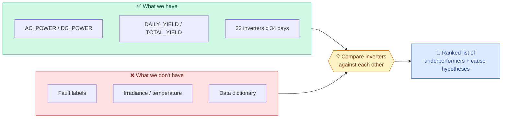

Since there are no labels to learn from, SolarGuard AI uses **unsupervised peer comparison**. Neighbouring inverters share the same sun, so they act as each other's reference, and **three different models vote** on who fell behind.

---

## ⚙️ How It Works

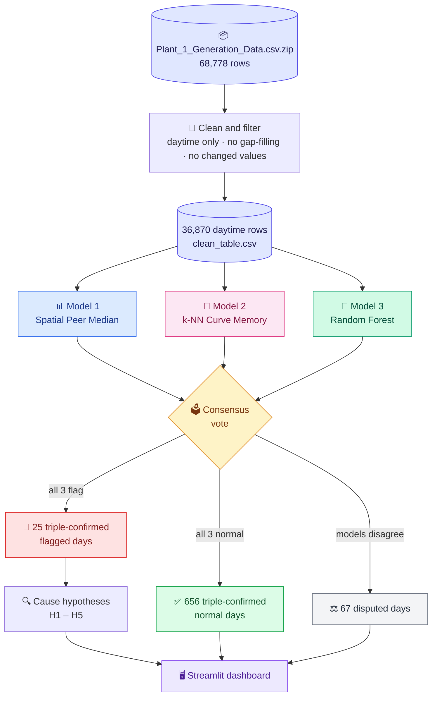

### 🌞 How "daytime" is defined

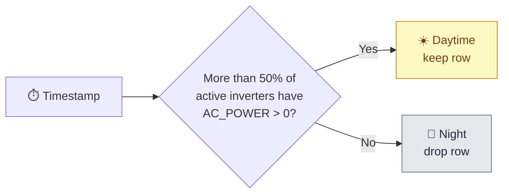

---

## 🤖 The Three Models

Three models that work in different ways have to *independently* agree before a day is called underperforming. Click a model to expand it.

<details open>
<summary><b>📊 Model 1: Real-Time Spatial Peer Median</b> <i>(baseline)</i></summary>

<br/>

For each inverter at each timestamp, the **median `AC_POWER` of the other 21 inverters** is the expected value. A daily `gap_pct` measures how far below its peers the inverter fell.

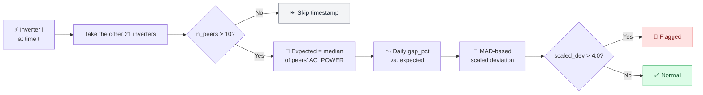

</details>

<details>
<summary><b>🧠 Model 2: k-NN Curve Memory</b></summary>

<br/>

A memory bank of **696 clean daily generation curves** (51 daytime slots each). Each inverter-day is scored by its Euclidean distance to the **3 nearest** normal historical profiles. If a day looks like nothing the plant has seen on a normal day, it's suspicious.

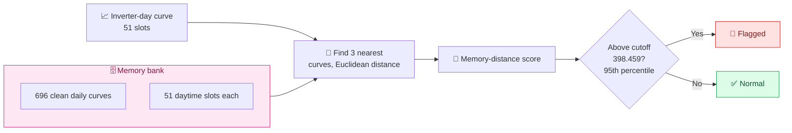

<p align="center">
  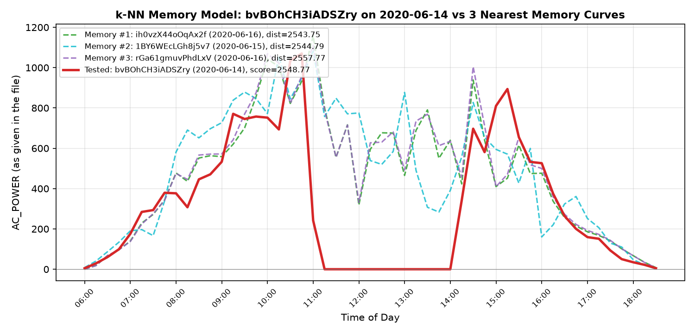
  <br/><sub><b>3-nearest curve retrieval</b> for a sample inverter-day</sub>
</p>

</details>

<details>
<summary><b>🌲 Model 3: Random Forest Regressor</b></summary>

<br/>

A **100-tree** Random Forest (`max_depth = 12`) trained on diurnal time cycles and peer distributions to predict `AC_POWER`. It reaches a test **R² of 96.60%** on unseen days (Days 25–34). Daily residuals are flagged with the same MAD outlier rule as Model 1.

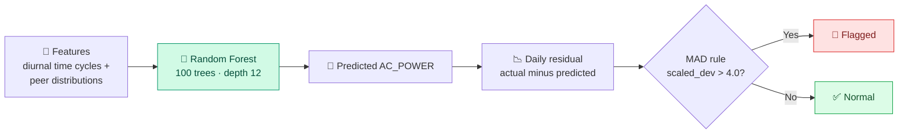

**Time-based split**, so the model never sees the future:

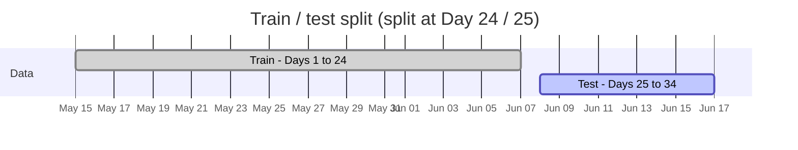

<p align="center">
  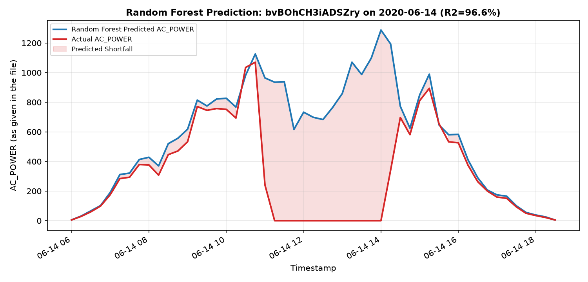
  <br/><sub><b>Predicted vs. actual</b> on held-out days</sub>
</p>

</details>

### 🗳️ Multi-Model Consensus

Across all **748 inverter-days**, the three models reach **91.04% agreement**. That isolates **25 triple-confirmed flagged days** where all three algorithms independently say *underperforming*.

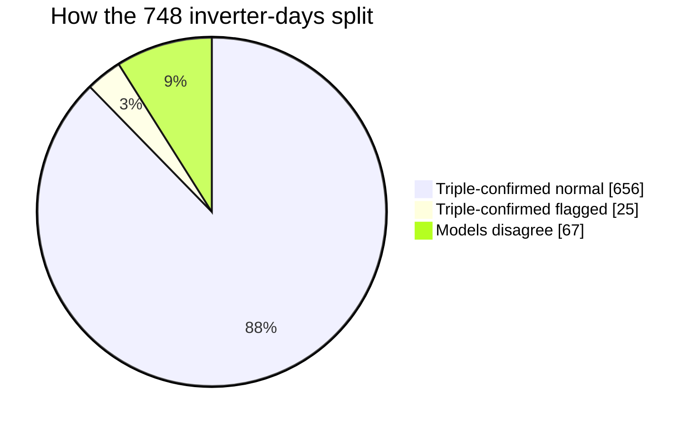

---

## 📈 Key Results

| | Metric | Value |
|:-:|---|---:|
| 🔢 | Total inverter-days analysed | **748** (22 × 34) |
| 🚩 | Inverter-days flagged (baseline) | **52** (6.95%) |
| ✅ | Triple-confirmed flagged days | **25** |
| 🟢 | Triple-confirmed normal days | **656** |
| 🤝 | Three-model consensus | **91.04%** |
| ⚡ | Full pipeline rebuild time | **2.25 s** |
| 💾 | Peak memory | **19.50 MiB** |

### 🎯 Problems are concentrated, not everywhere

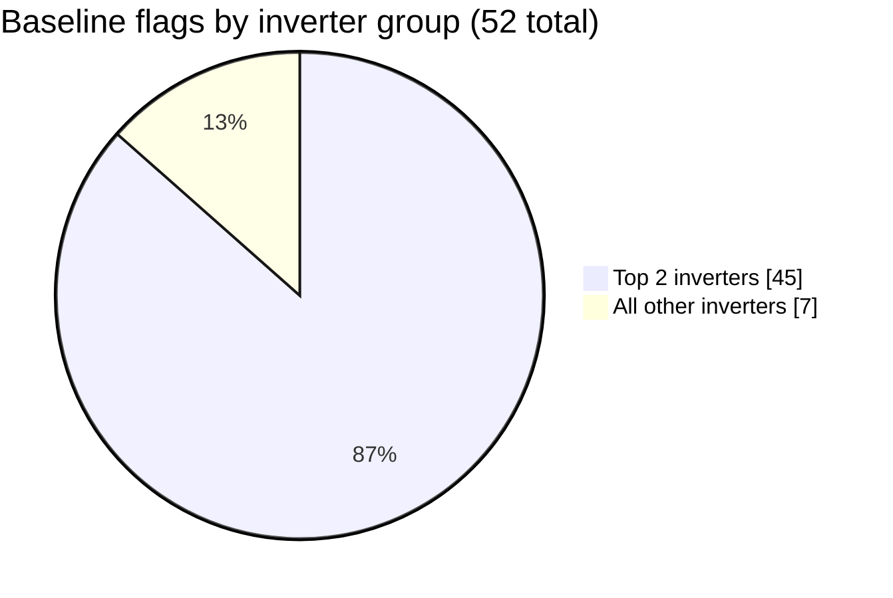

> **Two inverters account for 45 of the 52 baseline flags, and 14 of the 22 inverters are never flagged.** The shortlist for maintenance is short.

---

## 🔍 Cause Hypotheses

Every flagged inverter-day is checked against five patterns and gets **one or more** hypothesis labels.

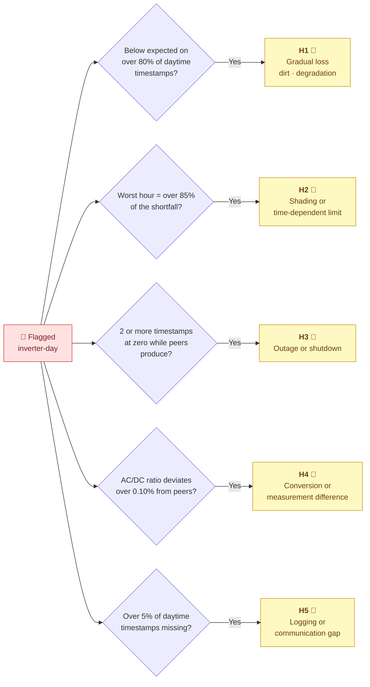

| Label | Pattern | Possible cause |
|:-:|---|---|
| **H1** | Below expected on >80% of daytime timestamps | Gradual loss (e.g. dirt, degradation) |
| **H2** | Worst hour accounts for >85% of shortfall | Shading or time-dependent limit |
| **H3** | ≥2 timestamps at zero while peers produce | Outage or shutdown |
| **H4** | AC/DC ratio deviates >0.10% from peers | Conversion or measurement difference |
| **H5** | >5% of daytime timestamps missing | Logging or communication gap |

> [!IMPORTANT]
> **Every cause is a hypothesis.** None can be confirmed from this dataset alone.

---

## 🚀 Quick Start

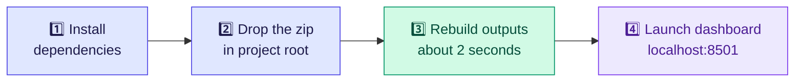

<details open>
<summary><b>1️⃣ Install prerequisites</b></summary>

<br/>

Requires **Python 3.10+**.

```bash
pip install pandas numpy matplotlib scikit-learn streamlit
```

</details>

<details open>
<summary><b>2️⃣ Rebuild all outputs from scratch</b></summary>

<br/>

Place `Plant_1_Generation_Data.csv.zip` in the project root, then run:

```bash
python outputs/run_all.py
```

Every table and plot is rebuilt from the original zip in **~2.25 seconds**.

</details>

<details open>
<summary><b>3️⃣ Launch the dashboard</b></summary>

<br/>

```bash
python -m streamlit run outputs/dashboard.py
```

Opens at **http://localhost:8501** with **four interactive tabs** covering all three models and the consensus view. It also supports drag-and-drop upload of new `.csv` or `.zip` datasets.

</details>

---

## 🗂️ Project Structure

<details>
<summary><b>Click to expand the file tree</b></summary>

```text
SolarGuard-AI/
├── README.md                              # This file
├── AGENTS.md                              # AI agent behaviour rules
├── PROJECT_STATE.md                       # All approved decisions and results
├── PROJECT_HANDOFF.md                     # Comprehensive handoff document
├── SolarGuard_Brief_and_Architecture.md   # Event brief and system architecture
│
├── outputs/                               # 📊 Pipeline outputs & dashboard
│   ├── run_all.py                         #   End-to-end rebuild script
│   ├── dashboard.py                       #   Streamlit multi-model app
│   ├── clean_table.csv                    #   36,870 daytime rows
│   ├── expected_table.csv                 #   Peer expected values
│   ├── daily_ranking.csv                  #   Daily gap % and MAD flags
│   ├── cause_hypotheses.csv               #   52 flagged days with H-labels
│   ├── final_daily_ranking.csv            #   Complete joined daily table
│   ├── plot_a_actual_vs_expected.png      #   Sample shortfall timeseries
│   ├── plot_b_gap_grid.png                #   22x34 heatmap
│   ├── summary.md                         #   One-page executive summary
│   └── demo_script.md                     #   2-minute spoken walkthrough
│
├── memoryNN/                              # 🧠 k-NN Curve Memory model
│   ├── knn_memory.py                      #   Memory bank construction
│   ├── run_knn_steps3_4.py                #   Anomaly scoring
│   ├── knn_memory_ranking.csv             #   748 rows of memory distances
│   └── plot_knn_memory_example.png        #   3-nearest curve retrieval
│
├── random_forest/                         # 🌲 Random Forest regressor
│   ├── rf_model.py                        #   100-tree RF regressor
│   ├── rf_model_ranking.csv               #   748 rows with RF flags
│   └── plot_rf_prediction_example.png     #   Predicted vs actual plot
│
└── base/                                  # 🧊 Preserved baseline snapshot
    ├── PROJECT_STATE.md
    ├── SolarGuard_Brief_and_Architecture.md
    └── outputs/                           #   Mirrored baseline outputs
```

</details>

---

## 📦 Dataset

**Source:** `Plant_1_Generation_Data.csv.zip` (872 KB compressed, ~4.8 MB extracted)

| Property | Value |
|---|---|
| Rows | 68,778 |
| Columns | `DATE_TIME`, `PLANT_ID`, `SOURCE_KEY`, `DC_POWER`, `AC_POWER`, `DAILY_YIELD`, `TOTAL_YIELD` |
| Plant | Single plant (ID `4135001`) |
| Inverters | 22 distinct `SOURCE_KEY` values |
| Date range | 2020-05-15 → 2020-06-17 (34 days) |
| Interval | 15-minute readings |
| Missing cells | 0 |

> [!NOTE]
> **Not in the file:** fault labels, irradiance, temperature, voltage, current, rated capacity, or a data dictionary.

---

## 📐 Approved Rules & Thresholds

All thresholds were derived from data distributions and approved by the team.

<details>
<summary><b>Click to see every approved rule</b></summary>

<br/>

| Rule | Approved value |
|---|---|
| Daytime definition | Timestamp where >50% of active inverters have `AC_POWER > 0` |
| Gap filling | **None** (no synthesised rows, no changed values) |
| Minimum peers | `n_peers ≥ 10` |
| Flag threshold (k) | `scaled_dev > 4.0` |
| Low coverage | `coverage_share < 95%` |
| k-NN neighbours | `k = 3`, distance cutoff = `398.459` (95th percentile) |
| Random Forest | 100 trees, `max_depth = 12`, time-split at Day 24/25 |

</details>

---

## ⚠️ Limitations

> [!WARNING]
> **"Flagged" means ranked low versus peers by an approved rule. It is not proof of a fault.**

| Limitation | What it means |
|---|---|
| 🏷️ **No fault labels** | There is no ground truth to validate against. |
| 📏 **Unknown units** | Values are reported exactly as given in the file. |
| 🌦️ **No weather data** | Dirt, shading and degradation can't be told apart. |
| 🌍 **Plant-wide problems are invisible** | If every inverter drops together, `gap_pct` stays near zero. |
| 📅 **34 days, one plant** | Nothing here generalises to another site or season. |
| 🧪 **Causes are hypotheses** | They are leads for inspection, not findings. |

---

## 🧰 Dependencies

| Package | Version used |
|---|---|
| Python | 3.13.14 |
| pandas | 3.1.0 |
| numpy | 2.5.4 |
| matplotlib | 3.11.2 |
| scikit-learn | 1.9.1 |
| streamlit | 1.66.1 |

---

## 👥 Team

<div align="center">

**TECHNOCRATS** · Team ID `U091EK2H`

Leader: **Jitinpal Singh** · Members: 3

*AI Sansad Technical MUN on AI & Innovation, Round 2 AI/ML Model Challenge*
*Bharati Vidyapeeth's College of Engineering, New Delhi*

</div>

## 📄 License

Licensed under the [MIT License](LICENSE). The dataset is provided by the AI Sansad competition organisers.

<div align="center">

<br/>

☀️ **If SolarGuard AI helped you, consider giving it a ⭐**

</div>
